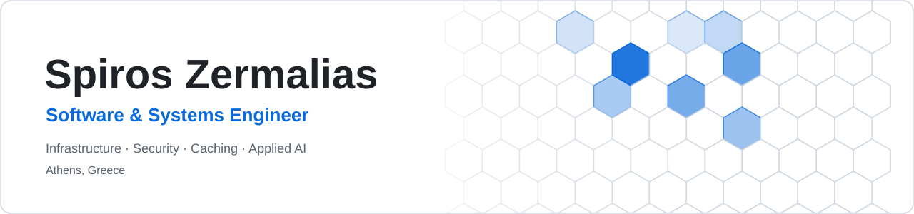

<picture>
  <source media="(prefers-color-scheme: dark)" srcset="assets/banner-dark.svg">
  <source media="(prefers-color-scheme: light)" srcset="assets/banner-light.svg">
  
</picture>

  <a href="https://spiroszermalias.com">spiroszermalias.com</a> &nbsp;·&nbsp;
  <a href="https://digen.gr">digen.gr</a> &nbsp;·&nbsp;
  <a href="https://www.linkedin.com/in/spiros-zermalias/">LinkedIn</a> &nbsp;·&nbsp;
  <a href="https://x.com/SZermalias">X</a> &nbsp;·&nbsp;
  <a href="mailto:lets.chat@digen.gr">lets.chat@digen.gr</a>

I run [Digital Engine](https://digen.gr), a small hosting and engineering practice in Athens. Most of
what I build is the infrastructure my clients' sites run on, plus the tooling around it: DDoS detection,
caching, server monitoring, ERP integrations, and a few LLM pipelines that extract structured data from
messy sources.

Nearly all of it lives in private repositories, so there is little to click on here. The projects
below are described rather than linked. If you want to see the code, get in touch and I can walk you through it.

## Selected work

### Phrouros
Layer 7 DDoS detection and Cloudflare mitigation, packaged as a Plesk extension.  Python, PHP, CloudLinux LVE, Cloudflare API, SQLite, Grafana

Application-layer attacks are made of valid requests, so nothing at the network level catches them and
the first symptom is usually a slow site. Phrouros learns a baseline for each site from its own history
(median and MAD), and flags an anomaly only when the traffic pattern in the access log and the resource
usage reported by CloudLinux drift away from that baseline at the same time. It then checks Cloudflare's
analytics and applies a Managed Challenge to the offending traffic only. It doesn't block anything, and
each site starts in shadow mode until I switch it on.

In production it has cut attack traffic by about 70% on average.

### Redis/APCu Object Cache
A WordPress object cache with three layers.  PHP 8.1, Redis, APCu, PHPUnit, PHPStan, Docker

APCu in-process is the first layer, Redis the second, and MySQL the fallback. The first layer doesn't
depend on Redis, so a site keeps serving from APCu when Redis goes down. It comes in a free and a paid
edition built on the same core. The WordPress cache API behaviour is covered by a conformance suite
that runs in Redis-only, APCu-only and tiered configurations, against real Redis and APCu, with failures
injected on purpose.

### Page Cache Manager
Keeps an nginx `proxy_cache` fresh for WordPress sites on Plesk and CloudLinux.  PHP, Python, nginx, systemd, WP-CLI

Open-source nginx can't purge, PHP can't read the cache directory, and CloudLinux doesn't give the site
a shell. The plugin works out which URLs a change affected (the post, its archives, the front page, shop
pages, Elementor's CSS) and re-requests them with a token that makes nginx bypass and overwrite the cached
copy. Large changes go to a companion Plesk extension, where a systemd unit running as the nginx user
invalidates the matching cache files. About 800 tests across unit, integration and artifact suites.

### Understudy
Load tests a prospect's current host and recommends one of my hosting plans.  Python, k6, Node.js, Express, SQLite, n8n

You give it a domain. It gets past the CDN to the origin, detects the platform (WordPress, WooCommerce,
Laravel, Node), crawls a weighted set of URLs and runs a k6 load test. The results are compared against
benchmarks I ran on my own hosting tiers, and the report goes out as a web page and a webhook into the CRM.

### OppScout
Collects Erasmus+ youth opportunities from many sources and publishes them automatically.  Python, Selenium, SQLite, OpenAI API, WordPress REST API

Three cron jobs connected through SQLite: one watches sources for changes, one scrapes and parses the
listings (PDF infopacks included) and has an LLM extract the details in English and Greek, and one
publishes to WordPress. Duplicates across sources are caught before anything is sent to the model.

### Other work
- AI Content Layout Engine, a WordPress plugin that rewrites product descriptions into structured
  layouts, validated against a schema and approved by a person before publishing. Works with several model providers.
- ERP to WooCommerce integrations, including Bridge 4 ERP and a SoftOne (S1) connector. At digital
  challenge_ this work halved integration turnaround time.
- IEP Voucher, a tool for distributing Panhellenic exam test papers, with a SOAP integration.
- A Cloudflare cache preloader that warms pages from sitemaps and tracks `cf-cache-status` per URL.

## Public repositories

| Repository | What it does |
| --- | --- |
| [new-project-wizard](https://github.com/spiroszermalias/new-project-wizard) | Sets up a new project for Claude Code: subagents, `CLAUDE.md`, git, licence, dev container |
| [common-dev-container](https://github.com/spiroszermalias/common-dev-container) | Dev container with a default-deny firewall for running coding agents |
| [autofill-excluder](https://github.com/spiroszermalias/autofill-excluder) | Chromium extension that turns off autofill on sites you choose |
| [url-decoder](https://github.com/spiroszermalias/url-decoder) | Chromium extension that copies URLs in decoded form |

## How I work

I write down the reasons behind design decisions. The three projects above have about 270 decision
records between them. I test against real Redis, MariaDB and nginx rather than mocks wherever I can,
and anything that can affect a live site runs in a dry-run mode before it is allowed to act. I use
Claude Code a lot, with project documentation it has to follow, and I review what it changes.

## Tools

<picture>
  <source media="(prefers-color-scheme: dark)" srcset="https://skillicons.dev/icons?i=py,php,go,js,nodejs,laravel,wordpress,linux,bash,nginx,docker,cloudflare,redis,mysql,sqlite,grafana,selenium,git,githubactions&perline=19&theme=dark">
  <source media="(prefers-color-scheme: light)" srcset="https://skillicons.dev/icons?i=py,php,go,js,nodejs,laravel,wordpress,linux,bash,nginx,docker,cloudflare,redis,mysql,sqlite,grafana,selenium,git,githubactions&perline=19&theme=light">
  
</picture>

Plus Plesk and CloudLinux administration, REST and SOAP APIs, k6 and n8n.

## Other things

I founded [U-Grow](https://u-grow.gr), a youth education organisation that runs Erasmus+ projects and
exchanges, and I'm still its legal representative. At university I was sponsorship manager for
TEDxUniversityofCrete and a project manager at GreenTeam UoC, and my team won first prize at Startup Weekend
Heraklion in 2017 with a VR app for public speaking anxiety. My degree is in Materials Science and
Engineering from the University of Crete.

I speak Greek, English and some French.
